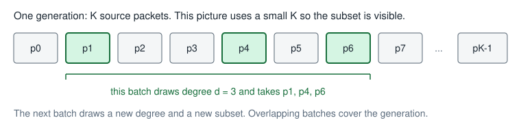
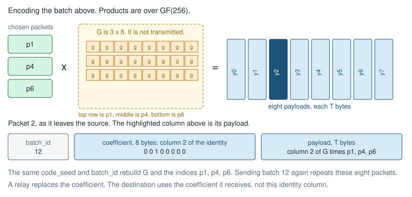
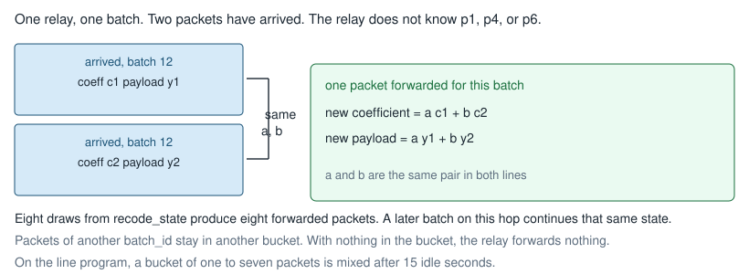
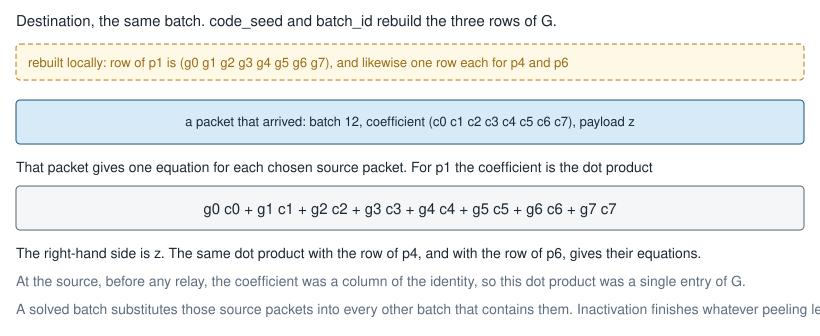
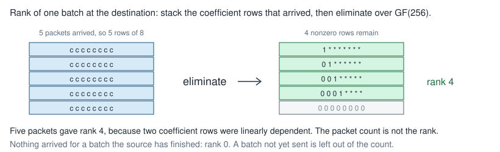
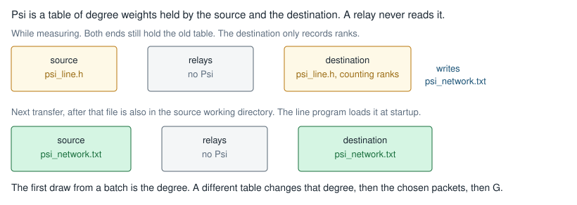

# Using BATS

A generation is `K` source packets of `T` bytes. The pictures below use one small batch so the mixing is visible. In the library that batch is eight packets, the degree `d` comes from Ψ, and the arithmetic is over GF(256). `G` and the chosen packet indices are never placed in a packet. The destination rebuilds them from `code_seed` and `batch_id`.

The source calls `bats_encode`. Each relay calls `bats_recode`. The destination calls `bats_decode`. A relay does not decode. The destination does not recode.

## What one batch takes from the generation



The degree is the number of source packets inside the batch. Eight packets can carry a rank of at most 8, so a batch whose degree is above 8 cannot be solved from its own arrivals. It becomes solvable after other batches have recovered some of those packets. A degree near 1 solves from very little data and unlocks the batches that overlap it. Ψ is the balance between those two.

## How the source builds the eight packets



`bats_encode` writes the eight packets into two buffers. Packet `j` starts at `coeff[j * 8]` and `payload[j * T]`. The call returns 0 on success.

```c
bats_encode(src, K, T, code_seed, batch_id, coeff, payload);
```

The next batch uses `batch_id + 1`. A generation that loses packets needs further batches. The following generation starts again at `batch_id` 0. The source stops a generation when the destination has solved it and the checksum matches. The library sends no signal of its own.

Pad the last source packet with zeros when the object is not a multiple of `T`. The checksum covers the object before that padding. `bats_decode` returns 1 when the equations it built have a solution. The checksum is what says those bytes are the object.

The source and the destination use the same `K`, the same `T`, and the same `code_seed`. On the line program the defaults are `K = 128`, `T = 4096`, and `code_seed = 0xB175`. Every packet carries the fields below. Multi-byte integers are big-endian. The eight coefficient bytes are copied unchanged.

| Field | Size | Role in the picture |
| --- | --- | --- |
| Flow | 2 bytes | Keeps one flow's batches apart. One flow uses 0 |
| Generation | 4 bytes | Restarts `batch_id` for the next `K` packets |
| `batch_id` | 4 bytes | Selects which `G` the destination rebuilds |
| Coefficient | 8 bytes | How this payload was mixed, replaced at each relay |
| Payload | `T` bytes | The mixed bytes |

The line program packs these, plus its own magic, version, packet index, and file sizes, into a 44-byte header. Another program can keep its own header. These five values have to survive every hop.

## What a relay changes



The bucket key is flow, generation, and `batch_id`. One `bats_recode` call reads one bucket. `recode_state` is a `uint64_t` owned by the hop, one variable per flow. Set it to a nonzero value before the first recode of that flow and pass the same variable on every later batch, including the next generation. The library updates it. The next hop has its own variable.

A repeated coefficient is dropped. Packet `s` occupies `coeff_in[s * 8]` and `payload_in[s * T]`. When `n_in` is at least 1 the call writes eight packets and sets `n_out` to 8. When `n_in` is 0 it writes nothing. The buffers may overlap. Forward each new coefficient with its new payload.

```c
bats_recode(coeff_in, payload_in, n_in, T, &recode_state,
            coeff_out, payload_out, &n_out);
```

## What the destination solves



Each arrival becomes a `BatsSymbol`: `batch_id`, the eight coefficient bytes, and a pointer to `T` live payload bytes. Symbol order does not matter. The pointer stays valid until `bats_decode` returns. A return of 0 means the generation needs more packets. A return of `-1` means an argument is invalid. `n_bp` and `n_inact` may be `NULL`.

```c
bats_decode(symbols, n_symbols, K, T, code_seed, dst, NULL, NULL);
```

On a return of 1, strip the padding and compare the checksum. A match is the moment to signal the source. A mismatch means the two ends used different `K`, `T`, `code_seed`, or Ψ, and the solved bytes are not the object.

A second flow has its own flow identifier, its own `batch_id` sequence, its own symbols, and its own `recode_state` on each hop.

## Where the degree distribution sits





The line program does this in two transfers. Relays are the same in both.

On the first transfer there is no `psi_network.txt` in the working directory, so the source and the destination use `psi_line.h`. That table was computed for two relays and no added loss. The built-in weights 12, 30, 40, 44, 40, 36, 30, 24 are a different table, used only when a program never calls `psi_set`. Add `--fit-psi` on the destination only, with `--loss-percent 0` when the ranks should be those of the real path. This transfer keeps `psi_line.h` from the first packet to the last. At the end the destination prints the nine rank counts and writes `psi_network.txt`.

```bash
./build/bats_line --role dest --listen 9000 --output /tmp/bats_out.bin \
    --k 128 --t 4096 --seed 0xB175 --idle-sec 15 --fit-psi
```

Copy `psi_network.txt` into the directory where the source process starts. Run again without `--fit-psi`. Each end prints `装入度数 psi_network.txt` and uses that table. The checksum of this second object confirms that both ends loaded it. Delete the file on both machines to return to `psi_line.h`.

A changed path, relay count, or loss is another measuring transfer. `--fit-psi` again, then copy the new file over the old one at the source. `--fit-psi` on a relay is rejected, and so is `--fit-psi` together with `--copy`. A path other than the default name is passed back with `--psi` on both the source and the destination.

## Linking the codec into another program

```bash
make lib
gcc -std=c11 -I/path/to/bats caller.c /path/to/bats/libbats.a -o caller
```

The archive is `field.c`, `source.c`, `dest.c`, and `codec.c`. Include only `bats_codec.h`. Call `bats_init` once in each process before the first codec call. The pictures above are the three calls. `psi_opt` stays a separate tool. The library does not watch the network, so the program loads the file itself.

The measuring transfer calls no `psi_set`. Both ends then use the built-in weights. The destination counts the nine ranks over several hundred finished batches and runs:

```bash
make psi_opt
./psi_opt --eta-bar 0.98 --max-degree 128 --weights-out psi_network.txt \
    h0 h1 h2 h3 h4 h5 h6 h7 h8
```

`--max-degree` is `K` when `K` is below 128. `--eta-bar 0.98` matches the line program. The first number in the file is the maximum degree `D`. The next line is the weight of each degree from 1 through `D`. Lines that start with `#` are comments.

On the next transfer, after `bats_init` and before the first packet, the source and the destination both call `psi_set` with those weights. `weights[0]` is unused. The call returns 1 when the weights are accepted. A relay skips the call.
