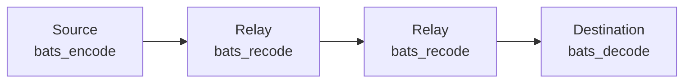
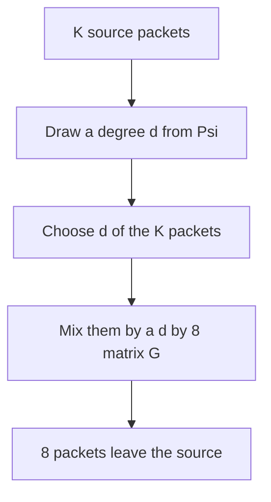
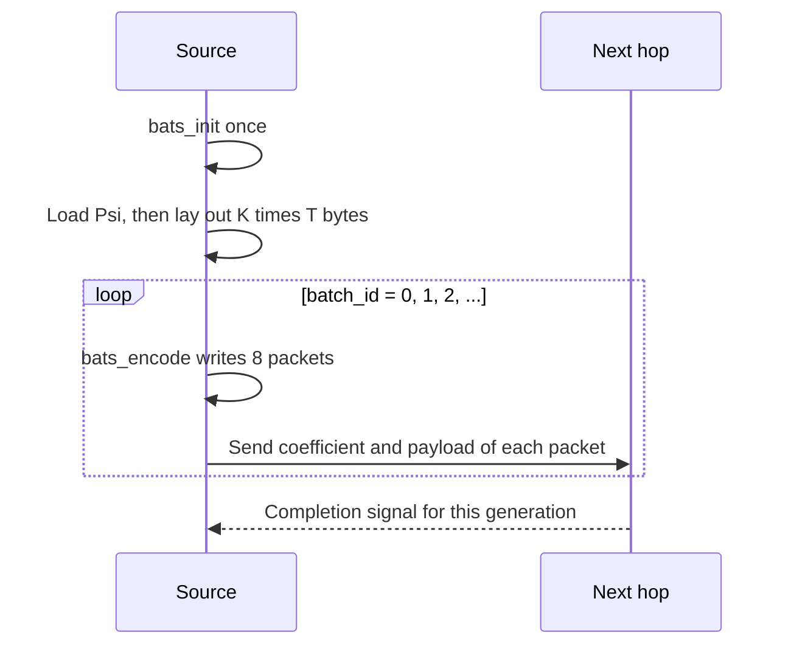
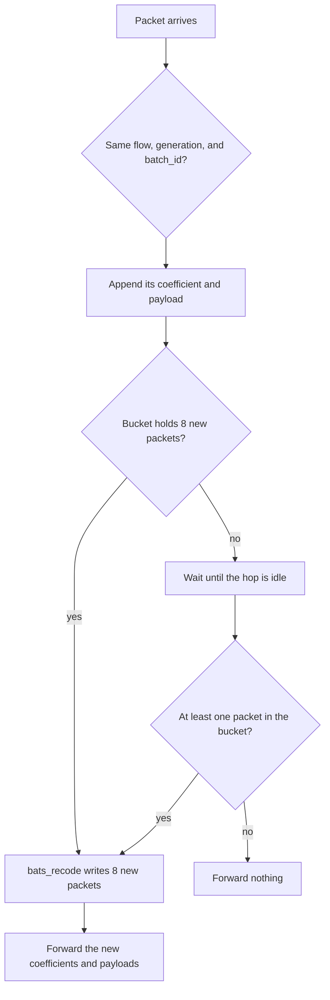
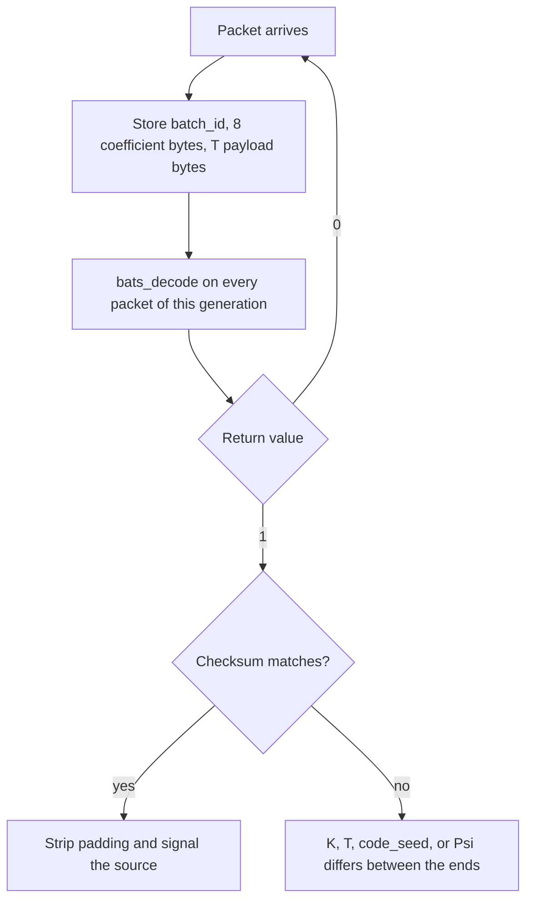
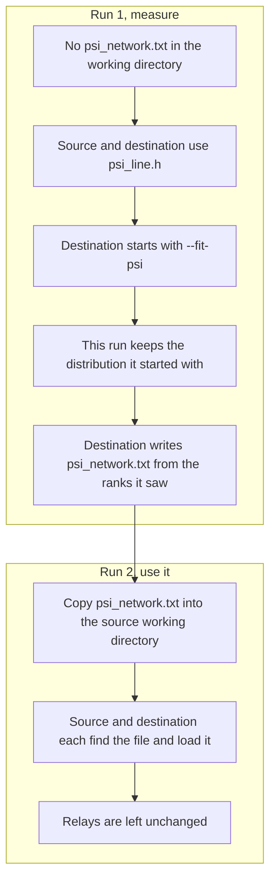

# Using BATS

One generation is `K` source packets of `T` bytes. The source turns that generation into batches of 8 packets. Each relay mixes packets that share one batch. The destination solves the generation. `G`, the matrix that mixed the source packets, is never placed in a packet. Both ends rebuild it from `code_seed` and `batch_id`.



A path may have one relay or several. Every relay does the same job. The destination does not recode. A relay does not decode, and it does not read the degree distribution.

## One batch



`G` and the `d` chosen indices stay at the source. The destination rebuilds the same choice from `code_seed` and `batch_id`. Packet `j` of a fresh batch carries column `j` of the 8 by 8 identity as its coefficient, and column `j` of the mixed payload. A relay replaces both. The destination needs the coefficient it actually receives.

The same `code_seed` and `batch_id` always rebuild the same batch. The next batch uses `batch_id + 1`. A generation that loses packets needs further batches. When the object is longer than one generation, start the next generation at `batch_id` 0.

## What you fix before the first packet

The source and the destination use the same `K`, the same `T`, and the same `code_seed`. On the line program those defaults are `K = 128`, `T = 4096`, and `code_seed = 0xB175`. A relay ignores all three.

Pad the last source packet with zeros when the object length is not a multiple of `T`. The destination strips that padding after a successful decode. Keep a checksum of the object bytes before that padding. `bats_decode` returns 1 when its equations have a solution. The checksum tells you those bytes are the object.

Every packet carries these fields. Multi-byte integers are big-endian. The 8 coefficient bytes are copied as they are.

| Field | Size | Who writes it |
| --- | --- | --- |
| Flow | 2 bytes | Caller. One flow uses 0 |
| Generation | 4 bytes | Caller. The first generation is 0 |
| `batch_id` | 4 bytes | The value passed to `bats_encode` |
| Coefficient | 8 bytes | Source, then replaced by each relay |
| Payload | `T` bytes | Source, then replaced by each relay |

The line program already packs these, plus its own magic, version, packet index, and file sizes, into a 44-byte header. Another program can keep its own header, provided the five fields above survive every hop.

## Source



`bats_encode` returns 0 on success. The coefficient buffer is 64 bytes, packet `j` at `coeff[j * 8]`. The payload buffer is `8 * T` bytes, packet `j` at `payload[j * T]`. Stop the generation when the destination has returned 1 and the checksum matches. The library itself sends no signal back.

```c
bats_encode(src, K, T, code_seed, batch_id, coeff, payload);
```

## Relay

A relay keeps one bucket per flow, generation, and `batch_id`. One call of `bats_recode` reads a single bucket. It also keeps one `uint64_t recode_state` per flow on that hop, set once to a nonzero value and then passed back in on every later batch. The library updates it. The next hop has its own variable. A new generation of the same flow keeps the same variable.



On the line program the idle wait is `--idle-sec`, default 15 seconds. A repeated coefficient is dropped before the call. Packet `s` in the call occupies `coeff_in[s * 8]` and `payload_in[s * T]`. With `n_in` at least 1 the call writes 8 packets and sets `n_out` to 8. With `n_in` equal to 0 it writes nothing. Input and output buffers may overlap. Forward the new coefficient with the new payload.

```c
bats_recode(coeff_in, payload_in, n_in, T, &recode_state,
            coeff_out, payload_out, &n_out);
```

## Destination



Symbol order does not matter. Each payload pointer stays valid until `bats_decode` returns. A return of 0 means the generation needs more packets. A return of `-1` means an argument is invalid. `n_bp` and `n_inact` may be `NULL`.

```c
bats_decode(symbols, n_symbols, K, T, code_seed, dst, NULL, NULL);
```

A second flow uses a new flow identifier, its own `batch_id` sequence, its own symbol array, and its own `recode_state` on each hop.

## Degree distribution on a new network

The line program fits Ψ on the path you just ran, then loads that file by itself on the next run. The library does not watch the network. A program that links `libbats.a` follows the same two runs and calls `psi_set` itself.

Relays never load Ψ. Both ends of a transfer use one distribution from the first packet to the last. The measurement run keeps the distribution it started with. The file it writes is for the next run.



`psi_line.h` is the distribution shipped with the line program, computed for two relays and no added loss. It is the distribution of run 1. The weights in `psi_builtin.h` are a different table, used only when a program never calls `psi_set`.

Build the line program on the Linux hosts, then run the usual four processes with the same `--k`, `--t`, and `--seed`. Set `--loss-percent 0` when the measurement should see the real path. Add `--fit-psi` on the destination only.

```bash
./build/bats_line --role dest --listen 9000 --output /tmp/bats_out.bin \
    --k 128 --t 4096 --seed 0xB175 --idle-sec 15 --fit-psi
```

The destination prints nine rank counts, ranks 0 through 8, then `度数已写入 psi_network.txt`. Rank is the GF(256) rank of the coefficient rows that arrived for one batch. A batch the source finished, and from which nothing arrived, counts as rank 0. A batch the source has not sent is omitted. Copy that file into the directory where the source process starts. Leave the relays alone.

Run again without `--fit-psi`. Source and destination each print `装入度数 psi_network.txt`. The checksum of this second object is the check that both ends loaded the same file. Delete the file on both machines to go back to `psi_line.h` and measure again.

A path, relay count, or loss that has changed is another run 1. Pass `--fit-psi` once more, copy the new file over the old one on the source, and the following run loads it.

`--fit-psi` belongs on the destination. Combined with `--copy` it is rejected. `--fit-psi /some/where/psi.txt` writes that path instead. The following run then passes `--psi /some/where/psi.txt` on both source and destination. The default name `psi_network.txt` needs no `--psi`.

## Linking the codec into another program

```bash
make lib
gcc -std=c11 -I/path/to/bats caller.c /path/to/bats/libbats.a -o caller
```

The archive is `field.c`, `source.c`, `dest.c`, and `codec.c`. Include only `bats_codec.h`. Call `bats_init` once in each process before the first codec call. `psi_opt` stays a separate tool.

The two runs are the same shape. On run 1, call no `psi_set`, so both ends use the built-in weights 12, 30, 40, 44, 40, 36, 30, 24 for degrees 1 through 8. At the destination, count the nine ranks over several hundred finished batches. Then:

```bash
make psi_opt
./psi_opt --eta-bar 0.98 --max-degree 128 --weights-out psi_network.txt \
    h0 h1 h2 h3 h4 h5 h6 h7 h8
```

`--max-degree` is `K` when `K` is below 128. Encoding already reduces a larger degree to `K`. `--eta-bar 0.98` matches the line program. The first number in the file is the maximum degree `D`. The next line is the integer weight of each degree from 1 through `D`. Lines that start with `#` are comments.

On run 2, after `bats_init` and before the first packet, source and destination both call `psi_set` with those weights. `weights[0]` is unused. The call returns 1 when the weights are accepted. A relay skips the call.
